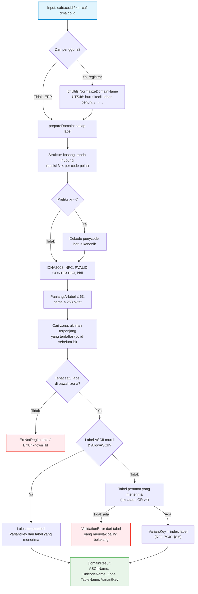
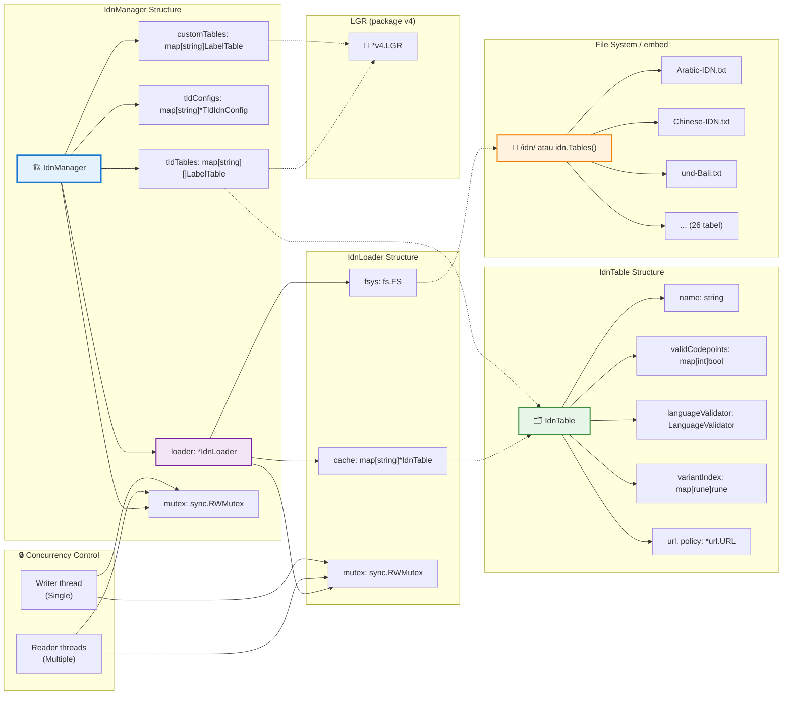
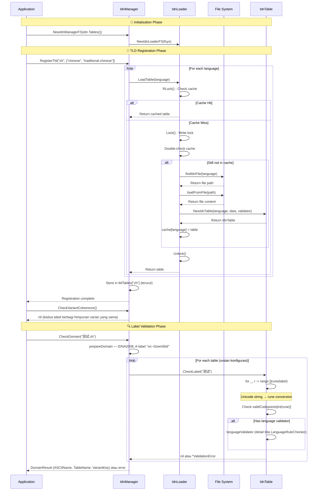

# Ref
- [IDN Repository Table ](https://www.iana.org/domains/idn-tables)
- [ICANN IDN Guideline](https://www.icann.org/resources/pages/implementation-guidelines-2012-02-25-en)
- ICANN IDN Implementation Guidelines 3.0 (2011) dan 4.1 (2022): `doc/idn-guidelines-*.pdf`


# RFC 
- [Internationalized Domain Names for Applications (IDNA)](https://datatracker.ietf.org/doc/html/rfc5890)
- [Internationalized Domain Names in Applications (IDNA): Protocol](https://datatracker.ietf.org/doc/html/rfc5891)
- [The Unicode Code Points and Internationalized Domain Names for Applications (IDNA)](https://datatracker.ietf.org/doc/html/rfc5892)
- [Right-to-Left Scripts for Internationalized Domain Names for Applications (IDNA)](https://datatracker.ietf.org/doc/html/rfc5893)
- [Representing Label Generation Rulesets Using XML](https://datatracker.ietf.org/doc/html/rfc7940) (LGR, package v4)

# Flow V3

### 1. **Load IDN Format dari Folder /idn**
```
📁 /idn/
├── Arabic-IDN.txt
├── Chinese-IDN.txt  
├── Japanese-IDN.txt
├── Hebrew-IDN.txt
├── und-Bali.txt
└── ... (26 tabel)
```

**Implementasi di idn_loader.go:**
- `NewIdnLoader(idnPath string)` - Loader dari folder di disk
- `NewIdnLoaderFS(fsys fs.FS)` - Loader dari `fs.FS`, mis. tabel yang disematkan di binary (`idn.Tables()`)
- `findIdnFile(language string)` - Mencocokkan nama bahasa dengan nama file tanpa `-IDN.txt` / `.txt`, tidak peka huruf besar/kecil: `latin` → `Latin-IDN.txt`, `und-bali` → `und-Bali.txt`
- `loadFromFile(filename string)` - Membaca file IDN line by line

### 2. **Register TLD ke idn_manager dengan Bahasa yang di-Support (untuk Caching)**
```go
// Di idn_manager.go
manager := NewIdnManagerFS(idn.Tables())
manager.RegisterTld("zh", []string{"chinese", "traditional-chinese"})

// Tabel LGR (package v4) didaftarkan dulu, lalu dipakai seperti tabel .txt
manager.RegisterTable(baliLGR)
manager.RegisterTld("id", []string{"latin", "und-bali"})
```

**Flow:**
- `IdnManager` menyimpan mapping: `TLD -> [Tabel1, Tabel2, ...]`, **terurut**: tabel pertama yang menerima label adalah tabel yang dicatat (idnTableId RDE)
- Setiap TLD punya `TldIdnConfig`: `Languages`, `Enabled`, `AllowASCII`, `TableRefs`
- Nama TLD dinormalisasi ke A-label huruf kecil (`ID.` → `id`, `рф` → `xn--p1ai`)
- Tables disimpan sebagai `map[string][]LabelTable` (copy-on-write); tabel dari `RegisterTable` diutamakan di atas file loader

### 3. **Caching Bahasa dengan Membaca File menggunakan sync.RWMutex**

**Implementasi Double-Check Locking Pattern di idn_loader.go:**
```go
func (loader *IdnLoader) LoadTable(language string) (*IdnTable, error) {
    language = normalizeLanguageName(language) // "Traditional Chinese" → "traditional-chinese"

    // 1. Read Lock - cek cache
    loader.mutex.RLock()
    if table, exists := loader.cache[language]; exists {
        loader.mutex.RUnlock()
        return table, nil
    }
    loader.mutex.RUnlock()

    // 2. Write Lock - load dan cache
    loader.mutex.Lock()
    defer loader.mutex.Unlock()

    // 3. Double-check locking
    if table, exists := loader.cache[language]; exists {
        return table, nil
    }

    // 4. Load dari file dan cache
    filename, err := loader.findIdnFile(language)
    data, err := loader.loadFromFile(filename)
    table, err := NewIdnTable(language, data, GetLanguageValidator(language))

    loader.cache[language] = table
    return table, nil
}
```

### 4. **Masukan Format Unicode ke Rune**

**Implementasi di idn.go** (label harus U-label yang sudah lolos IDNA2008):
```go
func (t *IdnTable) CheckLabel(label string) error {
    if label == "" {
        return newLabelError(ErrEmptyLabel, label)
    }
    for i, r := range []rune(label) { // <- Unicode string di-convert ke rune
        if !t.validCodepoints[int(r)] {
            return newRuneError(ErrCodepointNotInTable, label, i, r) // menyebut posisi
        }
    }
    if t.languageValidator != nil { // dipilih dari header "# Script:"
        return checkLanguageRules(t.languageValidator, t.name, label)
    }
    return nil
}
```

**Parsing Unicode dari File IDN** (`NewIdnTable`):
- `U+XXXX` → satu code point
- `U+XXXX..U+YYYY` → rentang
- `U+XXXX(ref);U+YYYY(ref);U+ZZZZ(ref),…` (RFC 3743) → code point + varian preferred + varian karakter
- header `# Script:`, `# Version:`, `# Effective Date:`, `# URL:`, `# Policy:`

## Diagram Flow IDN v3

```mermaid
flowchart TD
    %% === Application Initialization ===
    A[Application Start] --> B["NewIdnManagerFS(idn.Tables())<br/>atau NewIdnManager(idnPath)"]
    B --> C["NewIdnLoaderFS(fsys)"]
    C --> D["Initialize Cache: map[string]*IdnTable"]

    %% === TLD Registration ===
    D --> E["RegisterTld / RegisterTldConfig"]
    E --> F["Normalisasi zona ke A-label<br/>+ TldIdnConfig"]
    F --> G["resolveTable(language)<br/>RegisterTable dulu, lalu loader"]

    %% === Load Tables per Language ===
    G --> H{For each language}
    H --> I["LoadTable(language)"]

    %% === Cache Lookup with RWMutex ===
    I --> J{"Check Cache (RLock)"}
    J -->|Hit| K[Return Cached Table]
    J -->|Miss| L["Acquire WLock (Write Lock)"]

    %% === Double-Check Locking Pattern ===
    L --> M{Double-check Cache}
    M -->|Hit| K
    M -->|Miss| N["findIdnFile(language)"]

    %% === Load from IDN Folder ===
    N --> O["Load File<br/>Language-IDN.txt / und-Bali.txt"]
    O --> P["Parse U+XXXX, rentang,<br/>kolom varian RFC 3743"]
    P --> Q["NewIdnTable: validCodepoints,<br/>himpunan varian, validator per # Script:"]
    Q --> R["Cache Table in Memory<br/>(Protected by WLock)"]
    R --> S[Return Table]

    %% === Store in TLD Manager ===
    S --> T["Store in tldTables:<br/>TLD → []LabelTable (urutan prioritas)"]

    %% === Separate Label Validation Flow ===
    U["🔍 ValidateLabel(tldName, label)"] --> U2{"TLD terdaftar & aktif?"}
    U2 -->|Tidak| ERR["Error: ErrUnknownTld / ErrTldDisabled"]
    U2 -->|Ya| V["prepareLabel(label)<br/>A-label → U-label, IDNA2008"]
    V --> W{"For each table<br/>(urutan konfigurasi)"}
    W --> X["table.CheckLabel(ulabel)"]

    %% === Unicode to Rune Conversion ===
    X --> Y{"For each rune in label<br/>(Unicode → Rune conversion)"}
    Y --> Z["Check if rune exists in<br/>validCodepoints map"]
    Z --> AA["Return Validation Result<br/>(bool + tabel yang menerima, terurut)"]

    %% === Additional Language Validator ===
    Z --> BB{Language Validator exists?}
    BB -->|Yes| CC["Run language-specific<br/>validation rules"]
    BB -->|No| AA
    CC --> AA

    %% === Styling untuk clarity ===
    style A fill:#e1f5fe,stroke:#0288d1,stroke-width:2px
    style D fill:#f3e5f5,stroke:#8e24aa,stroke-width:2px
    style J fill:#fff3e0,stroke:#ff9800,stroke-width:2px
    style R fill:#e8f5e9,stroke:#4caf50,stroke-width:2px
    style U fill:#ffebee,stroke:#f44336,stroke-width:2px
    style Y fill:#fff9c4,stroke:#fbc02d,stroke-width:2px
    style Z fill:#fce4ec,stroke:#e91e63,stroke-width:2px
    
    %% === Connection dari Registration ke Validation ===
    T -.-> U
```



## Diagram Flow CheckDomain (Registry & Registrar)

Jalur yang dipakai registry (domain:create) dan registrar (sebelum EPP):



Registry menyimpan `ASCIIName` dan `VariantKey` dengan indeks unik
`(zona, variant_key)`; dua nama saling varian ⇔ kuncinya sama.

## Struktur Data Key

1. **IdnManager**
   ```go
   type IdnManager struct {
       loader       *IdnLoader                // Loader untuk file IDN
       tldConfigs   map[string]*TldIdnConfig  // TLD (A-label) -> Config
       tldTables    map[string][]LabelTable   // TLD -> tabel, urutan prioritas
       customTables map[string]LabelTable     // tabel dari RegisterTable (mis. LGR)
       mutex        sync.RWMutex              // Concurrent access protection
   }
   ```

2. **IdnLoader** 
   ```go
   type IdnLoader struct {
       fsys  fs.FS                  // Folder /idn atau tabel tersemat
       cache map[string]*IdnTable   // Language -> Cached Table
       mutex sync.RWMutex           // Cache protection
   }
   ```

3. **IdnTable**
   ```go
   type IdnTable struct {
       name              string            // Nama bahasa
       url, policy       *url.URL          // dari header; nil bila tidak ada
       script, version   string            // dari header
       validCodepoints   map[int]bool      // Unicode codepoint -> valid
       languageValidator LanguageValidator // Validator tambahan
       preferred         map[rune][]rune   // varian preferred (RFC 3743)
       variantIndex      map[rune]rune     // code point -> index himpunan varian
   }
   ```

4. **LabelTable** — antarmuka yang dipenuhi `*IdnTable` dan `*v4.LGR`
   ```go
   type LabelTable interface {
       GetName() string
       CheckLabel(label string) error
   }
   ```

## Key Features Flow:

1. **Lazy Loading**: Table hanya di-load saat dibutuhkan
2. **Thread-Safe Caching**: Menggunakan sync.RWMutex dengan double-check locking
3. **Unicode to Rune Conversion**: Otomatis saat validasi label
4. **Multi-TLD Support**: Satu manager bisa handle multiple TLD dengan bahasa berbeda
5. **Language Validation**: Support validator khusus per bahasa
6. **IDNA2008 sebelum tabel**: A-label didekode dan divalidasi sebelum dicocokkan dengan tabel
7. **Varian**: `VariantKey` per nama; koherensi antar tabel dicek `CheckVariantCoherence`

## Diagram Struktur Data dan Interaksi



## Diagram Sequence untuk Validation Process



Flow ini mengikuti best practices untuk concurrent access, memory efficiency, dan performance optimization dengan:

- **Double-check locking pattern** untuk menghindari race condition
- **RWMutex** untuk memisahkan read dan write operations
- **Copy-on-write** slice tabel per TLD, sehingga validasi tidak menahan lock
- **Lazy loading** untuk efisiensi memory
- **Unicode to Rune conversion** yang otomatis di Go
- **Multi-level caching** (IdnLoader cache + IdnManager tables)
